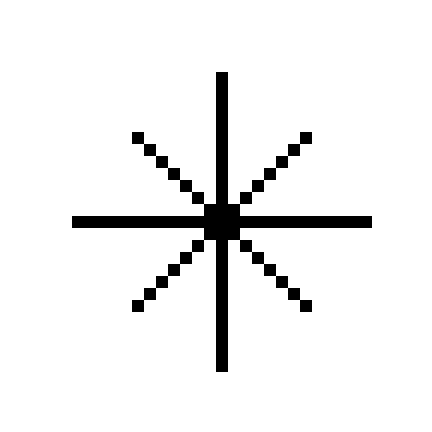
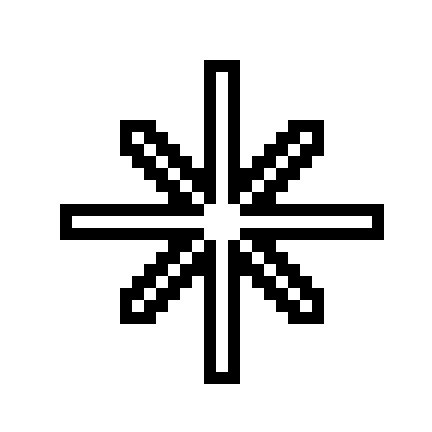
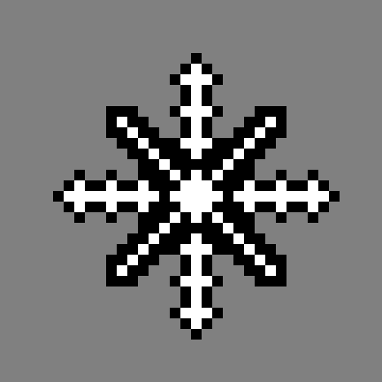
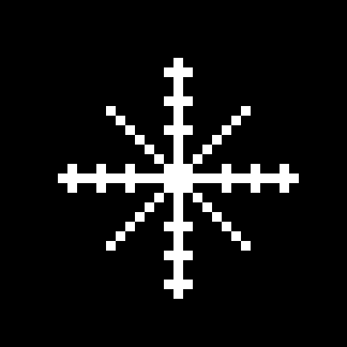
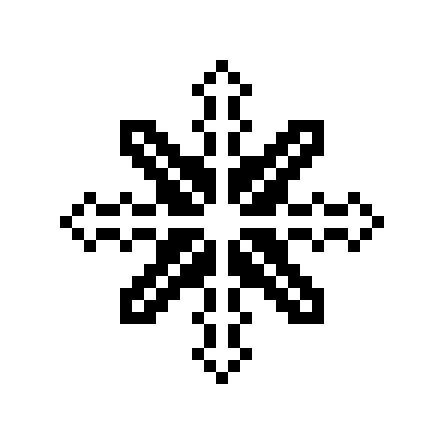
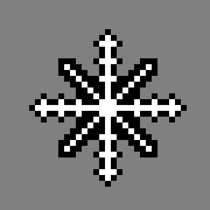
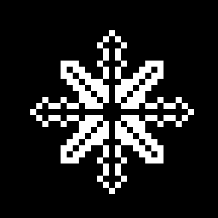
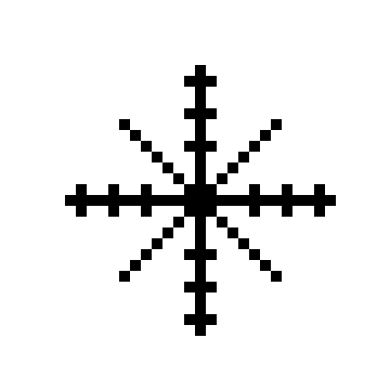
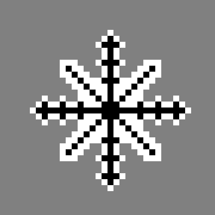

# X-Vector Cursor

A minimal eight-point star cursor for your desktop environment.<br>
B/W tone contrast to stay readable on black and white pages.

## Variants

**X-Vector** — white core, black outline. Built for dark desktops; the outline
keeps it readable on light pages.

<p align="center">
  
  
  
</p>

**X-Vector-Inverse** — black core, white outline. Built for light desktops;
the outline keeps it readable on dark pages.

<p align="center">
  
  
  
</p>

**X-Vector-Meta** — rhombic horizontal and vertical axes, the classic X
diagonals, and an eight-point centre. Built for dark desktops.

<p align="center">
  
  
  
</p>

**X-Vector-Meta-Inverse** — the Meta geometry with inverted tones. Built for
light desktops.

<p align="center">
  
  
  
</p>

**X-Vector-Meta-Link** — the Meta geometry with the four axial separators
bridged, so the arms meet the centre. Built for dark desktops.

<p align="center">
  
  
  
</p>

**X-Vector-Meta-Link-Inverse** — the Link geometry with inverted tones. Built
for light desktops.

<p align="center">
  
  
  
</p>

Preview tiles use a 36×36 canvas: the 28 px cursor plus 4 px breathing room on every side.

## Design

- **28 px** nominal size.
- Four main axes: **24 px** at the 28 px size (2 px margin on every side for the outline).
- Four diagonals: **14 px**.
- `X-Vector`: white **1 px** core; black **1 px** outline.
- `X-Vector-Inverse`: black **1 px** core; white **1 px** outline.
- `X-Vector-Meta`: rhombic axes; **3 px** rhombus core with a **1 px** outline
  at the 28 px size; the centre is an eight-point figure (a 3×3 square plus a
  5 px rhombus). The diagonals stay the classic X.
- `X-Vector-Meta-Link`: the same geometry as Meta, with the four axial
  separators bridged by one core pixel. The arms meet the centre and read as a
  compact hub; the diagonals and the outer contour stay unchanged.
- Meta and Link geometry snap to whole pixels. A rotated 1×1 square is smaller
  than a pixel at 28 px and would average to gray, so the smallest crisp
  rhombus is used instead. No anti-aliasing is applied.
- No centre dot.
- Static XCursor; no motion trail and no per-click animation (XCursor cannot
  receive global mouse-button events).

All six variants are two-tone cursors. On a matching background one layer
disappears, while the other keeps the star visible. `X-Vector`,
`X-Vector-Meta` and `X-Vector-Meta-Link` favor dark desktops; the three
`-Inverse` variants favor light ones. On mid-gray both layers are visible —
the unavoidable compromise of a two-tone cursor.

The text cursor is a three-stripe vertical sandwich, 8 px shorter than the
nominal cursor. `X-Vector` uses black-white-black; the inverse uses
white-black-white. Both survive dark and light input fields.

## Platforms

| Platform | Format | Guide |
| --- | --- | --- |
| Linux | XCursor | [Linux setup](docs/linux.md) |
| Windows | `.cur` + PowerShell installer | [Windows setup](platforms/windows/README.md) |
| macOS | Mousecape `.cape` | [macOS setup](platforms/macos/README.md) |

X-Vector is native on Linux. Windows and macOS use converted formats generated
from the same star geometry.

## Release

Current version: **1.3.0** — Linux, Windows and macOS packages, including the
`Meta` family and its `Link` variant.
Older releases are deprecated; use the latest one.
See [CHANGELOG.md](CHANGELOG.md) for details.

## Install

### Linux

The generated XCursor themes are committed, so Python is only needed when
rebuilding.

```bash
git clone https://github.com/369arc/x-vector-cursor.git
cd x-vector-cursor
./install.sh
```

The script installs all six variants and applies `X-Vector`. To apply the
Meta star:

```bash
./install.sh X-Vector-Meta
```

For the Link variant:

```bash
./install.sh X-Vector-Meta-Link
```

For the inverse variants, pass `X-Vector-Inverse`, `X-Vector-Meta-Inverse` or
`X-Vector-Meta-Link-Inverse`.

For Hyprland, GNOME, KDE Plasma, XFCE, Cinnamon, MATE, generic X11, GTK and
Flatpak instructions, see [docs/linux.md](docs/linux.md).

### Windows

Windows cannot load XCursor themes. Use the generated `.cur` package and the
PowerShell installer: [platforms/windows/README.md](platforms/windows/README.md).

### macOS

macOS needs a Mousecape cape: [platforms/macos/README.md](platforms/macos/README.md).

## Build

Requires Python 3 (no external Python packages).

```bash
./build.sh
```

This regenerates all six XCursor themes and the Windows/macOS assets in
`platforms/`.

## Uninstall

```bash
./uninstall.sh
```

This removes the Linux themes. See the Windows and macOS guides for their
uninstall steps.

## License

MIT. X-Vector is an original cursor design.
