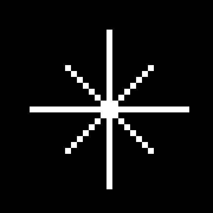
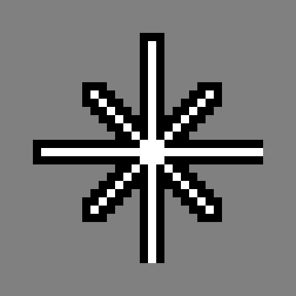

# X-Vector Cursor

A minimal eight-point star cursor for a pure-black desktop, with enough
two-tone contrast to stay readable on white pages.

<p align="center">
  
  
  
</p>

Preview tiles use a 36×36 canvas: the 28 px cursor plus 4 px breathing room on every side.

## Design

- **28 px** nominal size.
- Four main axes: **26 px** (1 px margin for the outline).
- Four diagonals: **14 px**.
- White **1 px** core; black **1 px** outline.
- No centre dot.
- Static XCursor; no motion trail and no per-click animation (XCursor cannot
  receive global mouse-button events).

The black outline disappears on a black background, leaving a white star.
On white it makes the star visible as a black outline. On mid-gray both
layers are visible — the unavoidable compromise of a two-tone cursor.

The text cursor is a black-white-black vertical sandwich, 8 px shorter than
the nominal cursor, so it survives both dark and light input fields.

## Install

The generated XCursor theme is committed, so Python is only needed when
rebuilding.

```bash
git clone https://github.com/369arc/x-vector-cursor.git
cd x-vector-cursor
./install.sh
```

The script copies the theme to `${XDG_DATA_HOME:-$HOME/.local/share}/icons`
and applies `X-Vector` for the current Hyprland session when `hyprctl`
is available.

### Hyprland

```ini
env = XCURSOR_THEME,X-Vector
env = XCURSOR_SIZE,28
env = HYPRCURSOR_THEME,X-Vector
env = HYPRCURSOR_SIZE,28
```

Or apply immediately:

```bash
hyprctl setcursor X-Vector 28
```

### GTK

```bash
gsettings set org.gnome.desktop.interface cursor-theme 'X-Vector'
gsettings set org.gnome.desktop.interface cursor-size 28
```

## Build

Requires Python 3 (no external Python packages).

```bash
./build.sh
```

This regenerates `themes/X-Vector` from the script in `src/`.

## Uninstall

```bash
./uninstall.sh
```

Then switch to another theme with `hyprctl setcursor` / your environment.

## License

MIT. X-Vector is an original cursor design.
